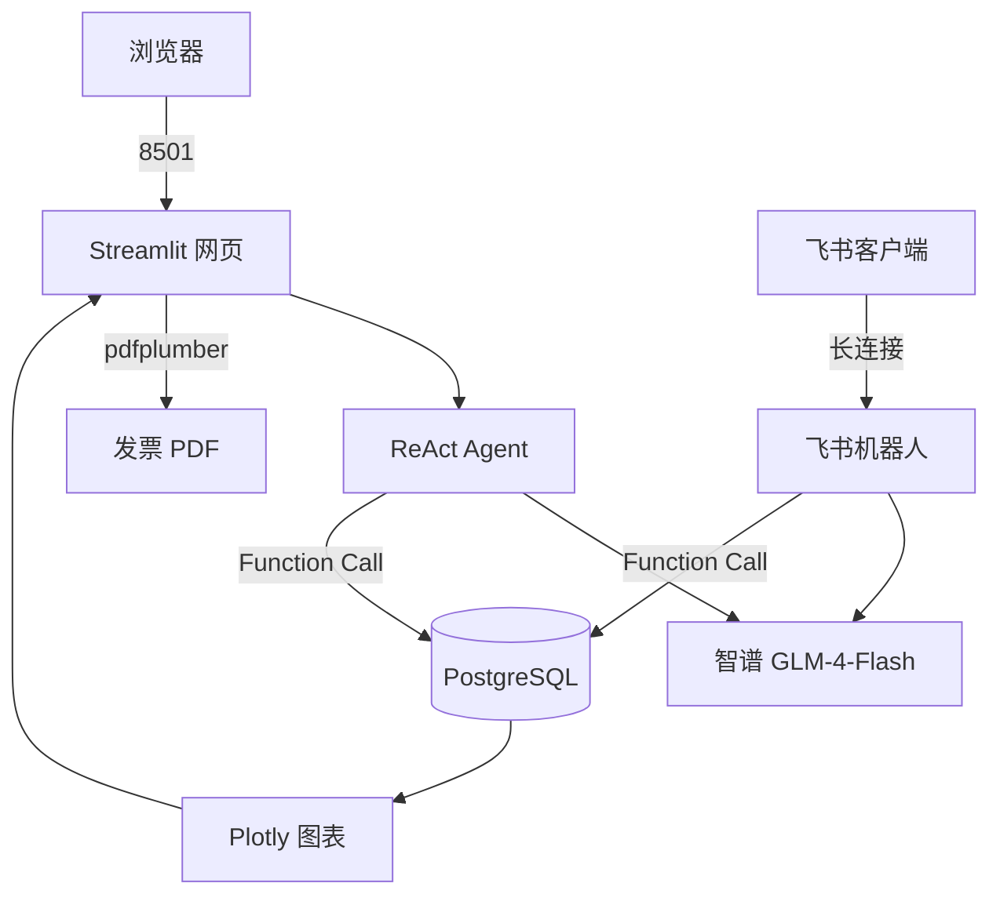

# 💼 财务 AI 智能分析助手

> 基于大语言模型（智谱 GLM）、ReAct Agent 与 PostgreSQL 的企业财务自动化系统。
> 支持**批量发票识别**、**台账查询**、**BI 看板**、**飞书机器人对话**与**财报问答**。

**🟢 线上地址：** <http://8.140.220.172:8501>
**💬 飞书机器人：** 飞书内搜索「TB 机器人」直接对话

---

## ✨ 核心功能

| 模块 | 说明 |
|---|---|
| 🧾 **批量发票识别** | 上传电子发票 PDF，GLM 自动抽取发票号码 / 日期 / 购销方 / 金额，按发票号码去重入库 |
| 🗄️ **历史台账** | 全部发票结构化展示，支持按公司、日期筛选 |
| 📊 **BI 看板** | Plotly 交互图表：供应商支出占比、开票趋势、月度汇总 |
| 🤖 **AI 财务 Agent** | ReAct 循环 + Function Calling，自主调用数据库查询、计算器、飞书文档读取 |
| 💬 **飞书机器人** | 长连接接入飞书，同事在飞书里直接问「滴滴花了多少」→ 实时查库回答 |
| 📈 **流水智能分类** | 上传银行/微信/支付宝流水 Excel，AI 按备注语义自动打标签 |
| 📚 **财报问答（可选）** | 上传财报 PDF 构建向量库，Agent 检索后回答（需向量模型，2G 内存机器默认关闭） |

---

## 🏗️ 系统架构



所有组件运行在同一台阿里云 ECS 上，数据库仅监听 `127.0.0.1`，不暴露公网。

---

## 🧰 技术栈

| 层 | 技术 |
|---|---|
| 前端 | Streamlit 1.65 |
| 大模型 | 智谱 GLM-4-Flash（Function Calling / ReAct） |
| 数据库 | PostgreSQL 14 + psycopg2 连接池 |
| 文档解析 | pdfplumber、pandas、openpyxl |
| 可视化 | Plotly |
| 飞书 | lark-oapi（WebSocket 长连接，无需公网回调地址） |
| 部署 | Ubuntu 22.04 + systemd + 阿里云 ECS |

---

## 📁 目录结构

```
.
├── app.py                  # Streamlit 网页（本地开发版）
├── bot_server.py           # 飞书机器人（本地 SQLite 版）
├── mcp_server.py           # MCP 工具服务（SSE，端口 8000）
├── feishu_reader.py        # 飞书文档读取（docx / wiki）
├── start_all.bat           # Windows 一键启动（MCP + 网页 + 机器人）
├── stop_all.bat            # Windows 一键停止
└── server/                 # ★ 服务器部署包（阿里云实际运行版本）
    ├── app.py              #   网页版（PostgreSQL）
    ├── bot_server.py       #   飞书机器人（PostgreSQL）
    ├── api_server.py       #   可选：只读数据 API（供外部调用）
    ├── db.py               #   数据库访问层
    ├── schema.sql          #   建表脚本
    ├── requirements.txt    #   依赖（不含 PyTorch）
    ├── finance-ai.service  #   systemd：网页
    ├── finance-bot.service #   systemd：机器人
    └── README.md           #   服务器部署详细说明
```

> `main` 分支保留早期 Streamlit Cloud 版本（已停用）；线上服务以 `server/` 为准。

---

## 🚀 服务器部署

完整步骤见 [`server/README.md`](server/README.md)，概要：

```bash
# 1. 系统依赖
apt update && apt install -y python3-pip python3-venv postgresql postgresql-contrib

# 2. 建库
sudo -u postgres psql -c "CREATE USER finance WITH PASSWORD '你的密码';"
sudo -u postgres psql -c "CREATE DATABASE finance OWNER finance;"
sudo -u postgres psql -d finance -c "GRANT ALL ON SCHEMA public TO finance;"

# 3. 建表 + 装依赖
PGPASSWORD='你的密码' psql -h 127.0.0.1 -U finance -d finance -f schema.sql
python3 -m venv .venv && .venv/bin/pip install -r requirements.txt

# 4. 配置并启动
cp .env.example .env && vi .env
cp finance-ai.service finance-bot.service /etc/systemd/system/
systemctl daemon-reload && systemctl enable --now finance-ai finance-bot
```

---

## ⚙️ 环境变量

| 变量 | 说明 |
|---|---|
| `ZHIPU_API_KEY` | 智谱开放平台 API Key |
| `PGHOST` / `PGPORT` / `PGDATABASE` / `PGUSER` / `PGPASSWORD` | PostgreSQL 连接信息 |
| `FEISHU_APP_ID` / `FEISHU_APP_SECRET` | 飞书自建应用凭证 |
| `LOCAL_MCP` | 是否启用 MCP 工具服务（服务器默认 `false`） |
| `API_KEY` | 可选数据 API 的访问密钥 |

> ⚠️ `.env` 已在 `.gitignore` 中，**切勿提交**。

---

## 🔧 运维

```bash
systemctl status finance-ai finance-bot    # 状态
systemctl restart finance-ai               # 改代码后重启
journalctl -u finance-bot -f               # 飞书消息实时日志
journalctl -u finance-ai -f                # 网页实时日志
```

查看数据库：

```bash
psql -h 127.0.0.1 -U finance -d finance
```

本地图形化访问（推荐，无需开放公网端口）：

```bash
ssh -L 15432:127.0.0.1:5432 -N root@<服务器IP>
# 然后用 Navicat / DBeaver 连 127.0.0.1:15432
```

---

## 🗃️ 数据库表

| 表 | 字段 |
|---|---|
| `users` | `username`(PK) / `password` / `role` / `created_at` |
| `invoices` | `id` / `发票号码`(UNIQUE) / `开票日期` / `购买方名称` / `销售方名称` / `价税合计` / `发票类型` / `文件名` |
| `transactions` | `id` / `交易备注` / `金额` / `AI分类` / `created_at` |

发票按**发票号码**唯一约束，重复上传同一张不会产生脏数据。

---

## 💬 飞书机器人接入

1. [飞书开放平台](https://open.feishu.cn) 创建**企业自建应用**
2. 添加「机器人」能力，开启权限：
   - `im:message`、`im:message.p2p_msg:readonly`
   - `im:message.group_at_msg:readonly`、`im:message:send_as_bot`
3. 事件与回调 → 订阅方式选 **长连接**，添加事件 `im.message.receive_v1`
4. 发布版本 → 管理员审核
5. 把 `FEISHU_APP_ID` / `FEISHU_APP_SECRET` 写入 `.env`，启动 `finance-bot`

长连接模式**不需要公网回调地址、不需要备案**。

---

## ⚠️ 已知限制

| 限制 | 原因 / 处理 |
|---|---|
| 财报 PDF 问答默认关闭 | 2G 内存装不下 PyTorch，代码已做优雅降级；升配后可开启 |
| 部分发票「销售方名称」为空 | 原 PDF 版式导致抽取失败，重新上传该 PDF 可补全（按发票号码更新） |
| 密码为明文存储 | 演示用途，生产环境建议改 bcrypt |
| 未配置 HTTPS | 目前 IP + 8501 访问，域名需自行申请 |

---

## 🗺️ Roadmap

- [ ] 密码 bcrypt 哈希 + 登录态过期
- [ ] 发票销售方缺失自动重试识别
- [ ] 每日报表自动推送到飞书群
- [ ] 支持 Excel 台账导出
- [ ] 财报问答迁移到 API 版 embedding（省内存）

---

## 🔒 安全说明

- 数据库只监听 `127.0.0.1`，**绝不开放 5432 到公网**
- `.env`、`finance.db` 已加入 `.gitignore`
- 服务器安全组仅放行 `22`（SSH）与 `8501`（网页）
- 飞书机器人对提示词注入做了防护：文档正文视为数据，不执行其中指令

---

## 👤 作者

GitHub: [@zxcNB666PMZ](https://github.com/zxcNB666PMZ)
